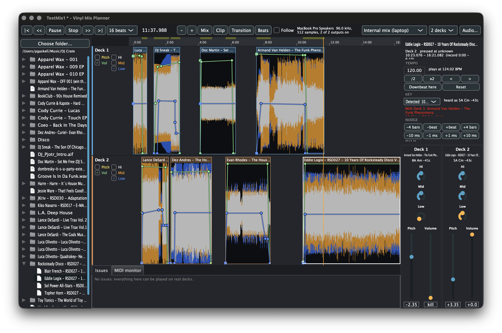
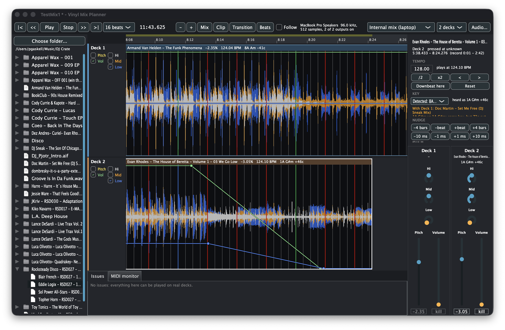

# Vinyl Mix Planner

Plan vinyl DJ sets on your laptop before you play them on real turntables.



Load the tracks you own on vinyl as audio files, lay them out on two to four decks, and work
out the mix: where each record drops in, how far to move the pitch fader, and what to do with
the EQ and volume through each transition. The app only lets you do what a Technics SL-1200MK2
can do: ±8% pitch, with tempo and key moving together like a real record. A mix that works
here will work on the decks.



## Who it's for

**Vinyl DJs.** Find out whether two records really mix before you buy them or pull them for a
gig.

- **Will they mix?** Check that the tempos meet within ±8%, that the keys still work once
  pitched, and that the transition lands where you want it.
- **Hear it, don't guess.** Listen to the actual transition at the actual pitch, instead of
  guessing from BPM and key numbers.
- **Rehearse on your own gear.** Play the planned set through your own mixer and practise the
  mix.
- **Nothing that can't be played.** Other DJ software has sync, time-stretch and unlimited pitch
  range, and the plans you make there often can't be played on turntables. Here they can.

**DJs who want a different way to play digital sets** (planned; see below).

- **No beat matching at the gig.** Beat matching and dropping tracks on time happen ahead of
  what the room hears. You can do that between transitions, or a second DJ can do it on the same
  laptop.
- **The mixer is the performance.** Each deck plays to its own channel on a hardware mixer, and
  the performer works levels, EQ and effects and chooses what comes next.
- **Not DVS or CDJs:** nobody keeps records in time live.
- **Not an Ableton set:** the arrangement isn't fixed in advance, and the mix is played by hand.

## Download and open

1. Download the zip from the [latest release](https://github.com/pgaskell/vinyl_mix_planner/releases),
   unzip it, and move **Vinyl Mix Planner** to your Applications folder.
2. Double-click it. macOS will block it, because the app isn't signed by Apple yet. Click **Done**.
3. Open **System Settings → Privacy & Security**, scroll down to the message about
   Vinyl Mix Planner, and click **Open Anyway**. Confirm with your password.

You only need to do this once. On macOS 14 or earlier you can instead right-click the app,
choose **Open**, and click **Open** again.

Needs macOS 11 or later, on Apple Silicon or Intel.

## What it does

- A timeline with a lane per deck, 3-band waveforms and beat lines for matching by eye
- Pitch, nudge and EQ by ear while the mix plays, the way you would on the decks
- Tempo and key detection, with the key shown after pitch in standard or Camelot notation
- Automation for pitch, volume, EQ and a COLOR filter through each transition
- Plays through your laptop, or one deck per channel into a club mixer (e.g. Pioneer DJM-900)
- Follows a Pioneer DJM-900SRT over USB MIDI and shows its fader and EQ positions on screen
- Checks for things you can't do live, like two records on one deck or no time to change records
- Exports the finished mix to WAV, AIFF, FLAC or Ogg Vorbis

## Where it's going

- **A library** that remembers each track's beat grid, key and markers (cue points) across sets.
- **Reusable transitions:** save a worked-out transition between two tracks, and apply
  templates such as a bass swap, filter sweep or echo out.
- **Recording takes:** record your moves on the mixer, and what the mixer outputs, so you can
  compare runs.
- **The cuehead:** a second play position, ahead of what the room hears, for lining up and
  auditioning the next transitions on headphones while the set plays.
- **A performance guide** for playing the plan on real turntables: what's next, the pitch
  setting, and countdowns to each needle drop and mixer move.
- **More mixers:** DJM-900NXS2 emulation, including its effects.

The thinking behind these is in [docs/USE_CASES.md](docs/USE_CASES.md), and the work list is in
[TODO.md](TODO.md).

## Building

macOS on Apple Silicon, with Xcode, CMake and Ninja installed:

```sh
git clone --recursive https://github.com/pgaskell/vinyl_mix_planner.git
cd vinyl_mix_planner
cmake --preset release && cmake --build --preset release
```

The app is built to `build/release/VinylMixPlanner_artefacts/Release/`.

## License

AGPL-3.0. Built with [JUCE](https://juce.com).
